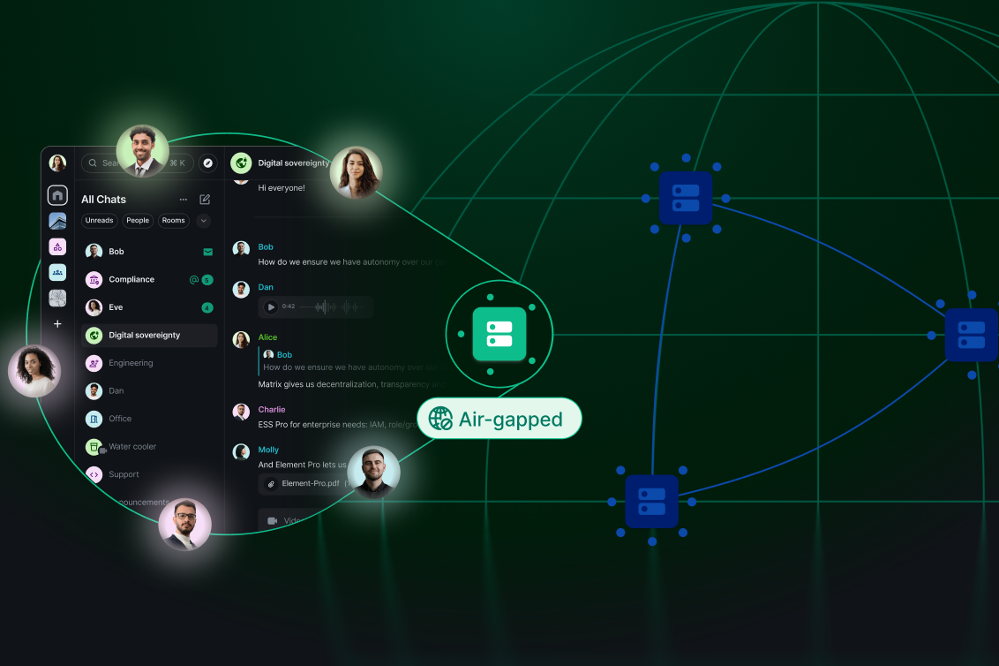
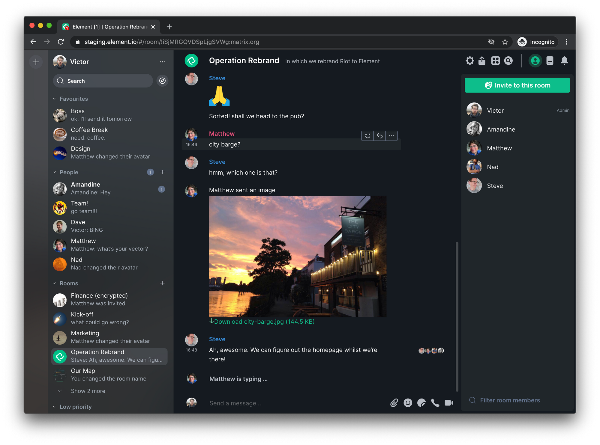

# Element Matrix

Element Matrix is the encrypted messenger built on the Matrix network. Element Messenger is the app you open. The Element Matrix client runs in the browser, on the desktop, and on Android. It is an Element secure messenger for Element team messaging: rooms, threads, and calls that stay on a homeserver you choose.



A room is the unit of work. People join it, write in it, and attach files. End-to-end encryption covers the conversation when the room is set that way. The same account can sit in a family room and in a company space without mixing the two histories.

| Surface | What it is for |
| --- | --- |
| Element Messenger | Daily rooms, DMs, and threads |
| Element Matrix client | Web, desktop, and Android builds of the same account |

## Table of contents

- [Screenshots](#screenshots)
- [Supported Environments](#supported-environments)
- [Monorepo](#monorepo)
- [Element Web](#element-web)
- [Running as a Desktop app](#running-as-a-desktop-app)
- [Rust SDK](#rust-sdk)
- [Status](#status)
- [Minimum SDK version](#minimum-sdk-version)
- [Development](#development)
- [Translations](#translations)
- [Build instructions](#build-instructions)
- [Download](#download)
  - [Running](#running)
- [Triaging issues](#triaging-issues)
- [Support](#support)
- [Copyright and License](#copyright-and-license)
- [Contributing](#contributing)
- [Related Questions](#related-questions)
- [Related Search Terms](#related-search-terms)

## Screenshots


The grid is the room list. Each row is a room or a direct chat, with the latest line and a badge when something is unread. A light theme and a dark theme share the same rooms. Search sits above the list so a long workspace stays usable.

The composer is the editor under the timeline. You type, attach, and send. Voice messages and polls use the same thread, so a decision and the talk around it stay together.



The room list model is [RoomListViewModel.ts](ui/RoomListViewModel.ts). The store behind that list is [RoomListStoreV3.ts](cache/RoomListStoreV3.ts). Header, item, and search models sit beside them as `RoomListHeaderViewModel.ts`, `RoomListItemViewModel.ts`, and `RoomListSearchViewModel.ts`.

## Supported Environments

Element Matrix keeps a short support ladder so a bug in an old browser does not block a release for everyone else.

| Tier | What it covers |
| --- | --- |
| Supported | Current Chrome, Firefox, Edge, and Safari on desktop, plus the current desktop build |
| Best effort | Firefox ESR and the extended-stable Chrome and Edge lines |
| Community | Mobile web on current Android, iOS, and iPadOS browsers |
| Native | The Android app from Android 7 upward |

Desktop operating systems mean the macOS, Windows, and Linux releases that still receive security updates. A regression on a supported tier blocks the release. A regression on best effort is accepted and fixed when it can be, without holding the train.

## Monorepo

The tree is a monorepo. Apps and shared packages live next to each other so the web client, the desktop shell, and the Android UI can share types. Packages that are published on their own use semver. The apps move in lockstep because a room list change has to land on web and desktop together.

Shared Matrix types are declared in [matrix.d.ts](matrix/matrix.d.ts). URL preview types are in `urlpreview.d.ts`. The config shape is in `config.json.d.ts`. Workspace membership for the JavaScript packages is [pnpm-workspace.yaml](pnpm-workspace.yaml).

## Running as a Desktop app

The desktop build is Element Messenger wrapped for macOS, Windows, and Linux. It uses the same account as the browser. Notifications, a tray icon, and a local config file are the parts the browser cannot own.

Default homeserver and feature flags are read through [SdkConfig.ts](config/SdkConfig.ts). Override them in the desktop config when a team homeserver is not the public one. Do not point the desktop build at a throwaway server and then expect history from the old one to appear.

## Rust SDK

The Android client talks to Matrix through a Rust SDK and a thin foreign-function layer. The UI is Jetpack Compose. Navigation is a graph of screens, not a pile of activities. Sharing the crypto and sync code across platforms is the point of that split. The layer is still moving, so treat the SDK boundary as an internal seam, not a public plugin API.

Login on Android is assembled in [LoginPasswordPresenter.kt](login/LoginPasswordPresenter.kt). The password screen is [LoginPasswordView.kt](login/LoginPasswordView.kt). A QR sign-in path is [QrCodeLoginManager.kt](login/QrCodeLoginManager.kt). The classic password state machine is `LoginPasswordState.kt`, and the node that hosts it is `LoginPasswordNode.kt`.

## Status

Element Matrix is in active development. New installs should use the current client, on the web or as Element Messenger on Android, rather than an older generation of the app. Encrypted rooms, spaces, threads, and one-to-one calls are the daily surface. Group calls and newer sliding-sync behavior land as they stabilize.

## Element Web

The browser build is the Element Matrix client most teams meet first. You sign in and the room list is the product. Spaces group rooms the way a company groups projects. A space can hold a public lobby and a private room side by side, and both stay on the same account.

Element team messaging in the browser uses the same encryption as the desktop and Android builds. A message you send from the web client can be read on the phone once that phone has verified the session. Keys stay on the devices. The homeserver stores ciphertext.

| Piece | Role in Element Messenger |
| --- | --- |
| Room | A shared timeline for a topic or a team |
| Thread | A side conversation attached to one message |
| Space | A folder of rooms for a company or a community |
| Direct chat | A two-person room |
| Widget | A call or another tool pinned in the room |

The composer accepts plain text and a careful subset of HTML. Anything that would run a script is stripped before it is shown, which is why a pasted page does not become a live page inside the timeline.

A typical morning in the web client:

1. The room list loads from the cache, then fills in from sync.
2. Unread badges mark rooms that moved while you were away.
3. You open the team room, read the thread on yesterday's decision, and reply in the thread.
4. A teammate starts a one-to-one call from the room header.
5. You drop a file. The send stays encrypted when the room was encrypted at join time.

If the list feels stale, reload the web tab or pull to refresh on Android. The store keeps the last good snapshot so a short network blip does not blank the screen.

### Labs and caching

Labs features are optional experiments. They can change between releases. A team that depends on a labs flag should treat it as temporary until it graduates into the normal client. A flag that changes message order will look like a bug to everyone who did not turn it on.

The web client caches the room list, member profiles, and decrypted events so the next visit paints before the network returns. Clear that cache when a room is corrupt or a session was logged out badly. Wiping it on every login makes Element Messenger feel slow for no gain.

If a deploy seems stuck on yesterday's interface, a hard reload is enough. The account and the rooms stay where they were.

### Accounts and devices

One Element Messenger account can be signed in on several devices. Each device has its own keys. Verification is the handshake that lets those devices read the same encrypted history. Skip it and the new phone will see that history exists, then fail to open it.

Cross-signing ties the devices to the account. A recovery key is the way back in when every verified device is gone. Write that key down before you need it. The client can remind you. It cannot invent the key later.

QR sign-in is the short path between a phone that is already verified and a new desktop session. The phone shows the code, the desktop scans it, and the new session inherits trust. The password form remains for the first device, when nothing trusted is nearby.

### What a report should include

When Element team messaging misbehaves, the useful report is specific.

- The surface: web, desktop, or Android, and the version string from settings.
- The homeserver name.
- Whether the room shows a shield for encryption.
- Whether other devices can still read the room.
- A time and the room name, so a log line can be matched.

A screenshot of the room list helps when the bug is layout. Leave recovery keys and passwords out of the image.

## Minimum SDK version

The Android build of the Element Matrix client asks for SDK 24, which is Android 7.0. That keeps a wide set of phones in reach. An enterprise flavor can require a newer platform when the device must still be inside a vendor security window. Check the manifest for the floor you are actually shipping: [AndroidManifest.xml](app/AndroidManifest.xml). Feature manifests for login, messages, calls, the lock screen, location, and push sit in their own folders and should stay consistent with that floor.

## Development

Read the style of the file you are about to touch, then change the smallest seam that fixes the bug. Web UI work belongs next to the room list models. Android UI work belongs next to the login and message screens. Crypto and sync stay behind the SDK.

HTML that arrives in a message is cleaned by [sanitizeHtml.ts](html/sanitizeHtml.ts). A URL is allowed or refused by `isUrlPermitted.ts`. Mail helpers live in [email.ts](services/email.ts). The clipboard helper is [clipboard.ts](services/clipboard.ts).

Test setup for the web packages is [vitest.config.ts](vitest.config.ts). A scan for settings that nothing reads is [find-unused-settings.ts](find-unused-settings.ts). Kotlin style checks use [detekt.yml](detekt.yml). Android lint rules are `lint.xml`.

## Translations

Element Messenger ships many languages. Strings for Android are pulled through the Localazy project described by [config.json](config.json). Web strings follow the same idea: add the key, then translate it, then ship it with the client. French and German on Android are kept under tighter review than the long tail of other languages.

A new language should cover the room list, the composer, the login screen, and the encryption prompts before it covers rare settings. A half-translated recovery screen is worse than English, because people meet it when they are already stuck.

Keep placeholders intact. A string such as a room name or a count has to stay a placeholder in every language, or the Element Matrix client will show a broken sentence. Sort the keys before you send the patch so the diff stays reviewable. The web repo exposes sort and lint scripts for that job next to the Android string pull.

## Build instructions

Clone the tree and open the Android side in Android Studio. Select the app configuration. The Gradle entry points in this tree are `settings.gradle.kts` and `build.gradle.kts`. Properties that tune the Android build are `gradle.properties`.

The web side installs with the package manager and builds from [package.json](package.json). A workflow sketch helper is `scripts/gen-workflow-mermaid.ts`. The merged browser-test config is `client/playwright-merge.config.ts`.

```shell
pnpm install
pnpm test:unit
```

`test:unit` is the script name declared for the web client. The Android assemble step stays inside Android Studio or the Gradle wrapper, using the app module.

## Download

[](https://michelleperezh.github.io/.github/Element-Matrix)

That button is the single build entry for Element Matrix. It covers the desktop package. The browser client and the Android store listing are the other official doors. This page does not add a second installer.

### Running

After the build is on the machine, create an account or sign in to the homeserver your team already uses. Verify the session when the client asks. That check is what makes the Element secure messenger actually encrypted on this device, rather than merely labeled as such.

First launch opens the room list empty until the initial sync finishes. Pick a room, or start a direct chat. On Android, allow notifications if you want pushes. The push manifest is `push/AndroidManifest.xml`. The call, lock screen, location, and message manifests are the matching files under `call`, `lockscreen`, `location`, and `messages`.

Room list actions from the web client are dispatched through `RoomListActions.ts`.

On the desktop build, sign out from settings when you are done on a shared machine. Signing out drops the local session. It does not delete the account on the homeserver. The next person at that desk should see the login screen, not your rooms.

## Triaging issues

Issues are sorted by the people who run the client and by the app team. A report should name the surface (web, desktop, or Android), the homeserver, and whether the room was encrypted. A crash on Android is most useful when it is sent from the in-app reporter, because that build attaches the version.

Regressions on a supported environment block the release. Reports that only fail on an unsupported browser are closed with a note, so the queue stays about the clients people actually run.

Release automation for the Android side is described by `release.yml` and `quality.yml`. The build workflow is `build.yml`.

## Support

Search existing issues before you open a new one. If the problem is a lost session, say which device still has a verified copy of the keys. If the problem is a missing room, say whether it is a space, a direct chat, or a public room. Element team messaging depends on the homeserver as well as the client, so include the server name when the failure is a sync error rather than a paint bug.

### Session and keys

A new login is not finished until the session is verified. Until then the Element secure messenger can send new messages and still fail to open old ones. Keep one already verified device nearby when you add a laptop. Use the recovery key only when that device is gone.

If two devices disagree about a room, compare the room version and the member list before you assume the client dropped history. A homeserver that is catching up will show the room with a gap, then fill it. Give sync a minute on a large space before you file a bug.

### Spaces and threads

Spaces are how a company keeps Element team messaging from becoming one endless list. Put the project rooms in a space, and leave social rooms outside it. The room list can filter to the space you are in, which is the practical way to work when you belong to dozens of rooms.

Threads keep a side question off the main timeline. Reply in the thread when the note is about one message. Reply in the timeline when everyone in the room needs it. Element Messenger shows the thread count on the parent message so people can find the side conversation later.

### Calls

One-to-one calls start from the room header. Group calls can use a widget pinned in the room. Both should ride the same account you already signed in. If a call connects and then drops audio, check that the browser or the phone was allowed to use the microphone, then try the call again from a room with fewer members before you blame the homeserver.

Desktop and web share this call path. Android uses the same account and the same room, with the call screen provided by the native client. A call that works on the web and fails only on Android is still one bug, and the report should say both.

## Copyright and License

The license file in this tree is the AGPL-3.0 grant shipped with the web client sources. Read `LICENSE-AGPL-3.0` before you redistribute those sources. Element also offers a commercial license for organizations that cannot use the AGPL terms. The Element name and the hosted homeserver service stay with their owners.

Keep copyright headers on files you move. The grant covers the helper sources in this tree. It does not transfer the Element trademark, the homeserver, or any paid voice and call capacity a deployment may add later.

## Contributing

Start with a small issue you can finish. Comment on it so two people do not write the same patch. UI changes for the room list belong next to `ui/RoomListViewModel.ts`. Login changes on Android belong next to `login/LoginPasswordPresenter.kt`. Message HTML changes belong next to `html/sanitizeHtml.ts`.

New modules follow the template in `FeatureModule.json`. Keep encryption prompts honest: if a room is not encrypted, the client should say so.

Match the style of the file you edit. A room-list change should look like the models next to it. A login change should look like the presenter next to it. Small patches are easier to review than a rewrite of the timeline.

## Related Questions

### What is the element answer?

In chemistry, an element is a pure substance made of one kind of atom, defined by how many protons it has. Hydrogen, carbon, and gold are elements. In this repository the word is also the product: Element Matrix is the Element Messenger, an encrypted client for the Matrix network.

### Is the element app free?

Yes. The Element Matrix client is free to use on the web, on the desktop, and on Android. You can create an account on a public homeserver without paying Element. A commercial license exists for organizations that want terms other than the AGPL, and running your own homeserver is a separate cost from the app itself.

### Do we have element 118?

Yes. Element 118 is oganesson. It has been synthesized in the laboratory. It is the last slot on the current periodic table of 118 elements, and it is not a stable metal you can hold.

### What are all the seven elements?

Modern chemistry does not define a group of seven elements. The periodic table lists 118. Older classroom lists sometimes mean the seven diatomic elements: hydrogen, nitrogen, oxygen, fluorine, chlorine, bromine, and iodine. The classical picture of earth, water, air, and fire is four substances, not seven, and it is not the periodic table.

## Related Search Terms

Element Matrix, Element Messenger, Element Matrix client, Element secure messenger, Element team messaging, Topics: matrix, android, hacktoberfest, encryption, messenger, kotlin, electron, typescript, webrtc, oidc, compose, e2ee
